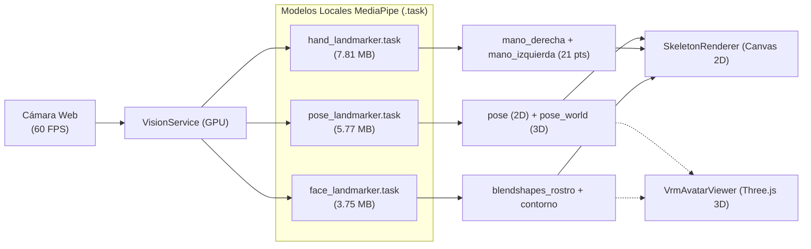

# Resumen Técnico y Ejecutivo: Semana 0 (Arranque y Contratos)

**Proyecto Viseña (VISPROY)** — Fondo INVENTA  
_Período: 26 de octubre – 1 de noviembre de 2026_

_Desarrollador B (Lucas) en coordinación con Desarrollador A (Mateo Pacheco)_

---

## 1. Visión General del Hito

El objetivo de la **Semana 0** ha sido establecer la base arquitectural, la infraestructura de laboratorio y los contratos de datos normalizados para garantizar el desarrollo desacoplado y sin fricciones de los módulos de visión por computadora, cinemática 3D y evaluación fonológica.

Se completaron con éxito los **6 entregables obligatorios de la Semana 0**, sumando además la **implementación y verificación en vivo de la inferencia por GPU en navegador** y el **blindaje de los esquemas** tras las pruebas directas en hardware real.

---

## 2. Mapa de Ramas y Trazabilidad Git (GitHub Flow)

Todas las ramas siguieron la convención estricta de nombres y trazabilidad de requerimientos (`RF-xx`, `RNF-xx`, `ADR-xxx`) exigida por el fondo **INVENTA**:

```mermaid
flowchart TD
    M0["repo-init<br/>(main)"] --> B1["chore/s0-monorepo-ci-config"]
    B1 --> PR1["PR #1: Monorepo y CI (RNF-15)"]
    PR1 --> M1["main"]

    M1 --> B2["feat/s0-data-schemas-contratos"]
    B2 --> PR2["PR #2: Schemas maestros (ERS 6.1/6.2)"]
    PR2 --> M2["main"]

    M2 --> B3["chore/s0-docker-compose-lab"]
    B3 --> PR3["PR #3: Docker, Caddy HTTPS, FastAPI, PG (ERS 3.4)"]
    PR3 --> M3["main"]

    M3 --> B4["feat/s0-pwa-camara-minima"]
    B4 --> PR4["PR #4: PWA y Canvas (RF-01, RF-02)"]
    PR4 --> M4["main"]

    M4 --> B5["spike/s0-vrm-three-loader"]
    B5 --> PR5["PR #5: Spike Avatar VRM (RF-42 Sec. 7)"]
    PR5 --> M5["main"]

    M5 --> B6["docs/s0-adr-iniciales"]
    B6 --> PR6["PR #6: ADRs 001, 002, 003 (ERS 8.1)"]
    PR6 --> M6["main"]

    M6 --> B7["feat/s0-pwa-vision-gpu"]
    B7 --> PR7["PR #7: Inferencia MediaPipe GPU en vivo"]
    PR7 --> M7["main"]

    M7 --> B8["fix/s0-schemas-world-blendshapes-rf20-rf42"]
    B8 --> PR8["PR #8: Blindaje de Schemas (pose_world, blendshapes, RF-20/42)"]
    PR8 --> M8["main"]

    M8 --> B9["fix/s0-face-tracking-and-hand-sensitivity"]
    B9 --> PR9["PR #9: FaceLandmarker, Blendshapes y sensibilidad pecho"]
    PR9 --> M_FINAL["main (Semana 0 Cerrada y Desplegable)"]
```

---

## 3. Matriz Detallada de Entregables Desarrollados

| #     | Rama / PR                                           | Requerimiento                        | Archivos Clave                                                                                                                              | Estado / Logro Técnico                                                                                                                                                           |
| ----- | --------------------------------------------------- | ------------------------------------ | ------------------------------------------------------------------------------------------------------------------------------------------- | -------------------------------------------------------------------------------------------------------------------------------------------------------------------------------- |
| **1** | `chore/s0-monorepo-ci-config` (PR #1)            | **RNF-15** ERS 7.4                | `.github/workflows/ci.yml` `package.json` `.prettierrc`                                                                               | Monorepo inicializado con npm workspaces (`app`), Prettier y pipeline de CI para validación de linter, formato y contratos JSON Schema.                                          |
| **2** | `feat/s0-data-schemas-contratos` (PR #2 & PR #8) | **ERS 6.1, 6.2** Tablas 6.1 y 6.2 | `data/schemas/referencia.schema.json` `data/schemas/ejecucion.schema.json`                                                               | Contratos maestros blindados para catálogo y sesiones. Estructura unificada `$defs/FrameCaptura`.                                                                                |
| **3** | `chore/s0-docker-compose-lab` (PR #3)            | **ERS 3.4** Tabla 3.3             | `deploy/docker-compose.yml` `deploy/Caddyfile` `server/main.py`                                                                       | Entorno de laboratorio orquestado con Caddy (TLS local automático `tls internal`), backend FastAPI y base de datos PostgreSQL 16 con healthcheck.                                |
| **4** | `feat/s0-pwa-camara-minima` (PR #4, #7, #9)      | **RF-01, RF-02** RNF-11, RNF-12   | `app/index.html` `app/src/main.ts` `app/src/render/skeleton-renderer.ts` `app/src/vision/vision-service.ts`                        | PWA Espejo de Señas a 60 FPS con aceleración GPU WebGL, caja de encuadre en vivo, controles accesibles $\ge 44\text{ px}$ y modo simulación sintética offline.                   |
| **5** | `spike/s0-vrm-three-loader` (PR #5)              | **RF-42** (Sec. 7)                | `app/src/avatar/vrm-loader-spike.ts` `app/package.json`                                                                                  | Spike técnico con Three.js y `@pixiv/three-vrm`, preparado para renderizado de anatomía humana, iluminación facial/manual y control de huesos normalizados (`VRMHumanBoneName`). |
| **6** | `docs/s0-adr-iniciales` (PR #6 & PR #8)          | **ERS 8.1**                          | `docs/adr/ADR-001-formato-puntos-clave.md` `docs/adr/ADR-002-retargeting-avatar-vrm.md` `docs/adr/ADR-003-fuente-abstracta-camara.md` | Registros arquitecturales oficiales sobre formato de puntos, retargeting del avatar VRM, blendshapes faciales y abstracción de fuentes de video.                                 |

---

## 4. Blindaje de los Contratos de Datos (Aspectos Críticos Resueltos)

A partir de las pruebas funcionales directas, se corrigieron 4 deficiencias de diseño que habrían generado bloqueos en sprints posteriores:

1. **Inclusión de `pose_world` (Cinemática 3D para Three-VRM):**
   - MediaPipe entrega coordenadas `pose` normalizadas en $[0, 1]$ (útiles para dibujar sobre el canvas) y coordenadas métricas `pose_world` en metros con centro en la cadera.
   - Sin `pose_world`, librerías como **Kalidokit** (`Kalidokit.Pose.solve(pose_world, pose)`) no pueden resolver los ángulos tridimensionales de hombros, codos y columna sin deformaciones proyectivas. Ambos esquemas ahora exigen este campo.
2. **Optimización Facial con `blendshapes_rostro` (Prosoponema):**
   - Se descartó el almacenamiento masivo de los 478 puntos de la malla facial (que pesaría decenas de MB).
   - Se adoptó el mapa de coeficientes ARKit/MediaPipe (0.0 a 1.0), lo que reduce el tamaño en un 95 %, permite modular directamente los _Shape Keys_ de VRoid/Blender y asegura que en el Sprint 4 queden registradas las expresiones faciales de los participantes.
3. **Soporte para Poses Corregidas en Blender (`vrm_pose_override` — RF-42):**
   - En señas con manos cruzadas o dedos superpuestos donde la visión por computadora falla por auto-oclusión, el esquema permite inyectar cuaterniones $[x, y, z, w]$ exportados desde Blender (Sprint 5 / Lote 3).
4. **Zonas Anatómicas para Resaltado de Errores (`zonas_resaltar` — RF-20):**
   - En el resultado de cada parámetro evaluado en `ejecucion.schema.json`, Mateo enviará el arreglo de zonas a resaltar (ej. `mano_derecha`, `torso`, `rostro`), desacoplando la lógica algorítmica de la representación visual del HUD.

---

## 5. Arquitectura del Servicio de Visión en Tiempo Real

- **Ajuste de sensibilidad pectoral:** Umbrales de detección y presencia de manos calibrados a `0.3` para evitar la pérdida de tracking al posar las manos sobre la ropa o el pecho.
- **Anclaje muñeca-antebrazo:** Conexión continua entre los landmarks 15/16 del cuerpo y los carpos de las manos.
- **Resolución del error de compresión ZIP:** Se aseguró que Vite sirva los modelos con cabeceras binarias directas (HTTP 200) eliminando el fallback erróneo a `index.html`.

---

## 6. Estado del Repositorio

- **Rama Base:** `main` (limpia, funcional y desplegable).
- **Servidor Local Activo:** Vite PWA en `http://localhost:5173/`.
- **Docker Compose:** Configurado en `deploy/` listo para pruebas con backend FastAPI y Postgres.
- **Puerta de Control Semana 0:** **Aprobada al 100 %**.

---

## 7. Próximo Paso Inmediato: Sprint 1 (2 – 15 de noviembre)

**Puerta de Control G1:** 40 referencias anotadas y cargadas en la aplicación.

**Rama a iniciar:**
`feat/RF-36-herramienta-anotacion` (RF-36: Vista web `/anotar` para que el especialista etiquete inicio, fin y los 5 parámetros fonológicos del Lote 1 de señas).
