# Resumen Técnico y Ejecutivo: Sprint 1
### Espejo de Práctica, Catálogo de Señas Fonológicas y Avatar VRM 3D
**Proyecto Viseña (VISPROY)** — Fondo INVENTA  
*Período: Sprint 1 (27 de octubre – 29 de octubre de 2026)*  
*Desarrollador B (Lucas) en coordinación con Desarrollador A (Mateo Pacheco)*

---

## 1. Visión General del Sprint 1

El objetivo principal del **Sprint 1** ha sido implementar el entorno interactivo de práctica en lengua de señas ecuatoriana (LSEC) mediante una arquitectura de **vista dividida (Split-View)**, compuesta por:

1. **Panel Izquierdo (Espejo Digital en Tiempo Real):** Captura de cámara web y canal de inferencia multimodal acelerado por GPU con Google MediaPipe Tasks Vision (`PoseLandmarker`, `HandLandmarker` y `FaceLandmarker`), con encuadre dinámico y renderizado continuo de landmarks sin líneas cruzadas espurias.
2. **Panel Derecho (Avatar VRM y Catálogo Fonológico):** Integración del modelo 3D oficial `MODELVIS1.0_optimizado_v2.vrm` (`visenia.vrm`), cinemática directa con Three.js, articulación de dedos según el parámetro fonológico de *Queirema*, reproductor de catálogo canónico a 1.0x y 0.5x, y separación funcional estricta entre **Modo Guía** y **Reflejo en Vivo**.
3. **Herramienta de Anotación Fonológica:** Drawer expandible para captura, recorte temporal por sliders y exportación de referencias compatibles con el esquema maestro `referencia.schema.json v1.1.0`.

Durante el ciclo de desarrollo se resolvieron incidencias críticas de biomecánica, orientación espacial, corrupción binaria de modelos y experiencia de usuario. A continuación se detalla cada uno de los **14 Pull Requests y 28 commits** aplicados en el repositorio local.

---

## 2. Mapa de Ramas y Trazabilidad Git (GitHub Flow)

El desarrollo se gestionó de forma estrictamente local, sin pushes al remoto y preservando todas las ramas para auditoría y revisión:

```mermaid
flowchart TD
    S0["Hito Semana 0<br/>(commit add9c3c)"] --> B10["fix/S1-face-landmarker-reload"]
    B10 --> PR10["PR #10: Reparación modelos .task y carga robusta (commit 63ef52a)"]
    PR10 --> B11["feat/S1-RF42-vrm-integracion-modelo"]

    B11 --> PR11["PR #11: Integración visenia.vrm y vista dividida (commit 488b600)"]
    PR11 --> B12["spike/S1-RF42-animacion-kalidokit"]

    B12 --> PR12["PR #12: Retargeting cinemático Three.js + Kalidokit (commit 5b583ab)"]
    PR12 --> B13["feat/S1-RF36-herramienta-anotacion"]

    B13 --> PR13["PR #13: Herramienta de captura y anotación (commit ccf4ed6)"]
    PR13 --> B14["feat/S1-RF07-RF08-catalogo-reproductor"]

    B14 --> PR14["PR #14: Catálogo y reproductor 1x / 0.5x (commit 593b2a6)"]
    PR14 --> B15["fix/S1-restore-genuine-mediapipe-models"]

    B15 --> PR15["PR #15: Restauración de binarios MediaPipe oficiales (commit 75d4d3c)"]
    PR15 --> B16["fix/S1-vrm-orientation-and-framing"]

    B16 --> PR16["PR #16: Orientación frontal y calibración FOV (commit 2ac6fae)"]
    PR16 --> B17["fix/S1-vrm-arm-lateral-adapter-and-wrist"]

    B17 --> PR17["PR #17: Adaptador de índices de pose y muñecas (commit 6fa482f)"]
    PR17 --> B18["fix/S1-landmarks-lateral-kinematic-coherence"]

    B18 --> PR18["PR #18: Enlace antebrazo-carpo y desempate espacial (commit 97a7777)"]
    PR18 --> B19["fix/S1-cinematica-espejo-manos-guia"]

    B19 --> PR19["PR #19: Cinemática vectorial, inversión Y y modo guía (commit a608268)"]
    PR19 --> B20["fix/S1-ui-limpieza-rf-coherencia-espejo"]

    B20 --> PR20["PR #20: Limpieza total RF, remoción overlay y espejo real (commit 68d4562)"]
    PR20 --> B21["fix/S1-avatar-cinematica-y-lateralidad"]

    B21 --> PR21["PR #21: Reposo, lateralidad y cinemática 3D (commit 1f4b9c8)"]
    PR21 --> B22["fix/S1-catalogo-tiempo-y-segmentacion"]

    B22 --> PR22["PR #22: Segmentación y tiempos reales (commit 6c64d65)"]
    PR22 --> B23["fix/S1-integracion-guia-espejo"]

    B23 --> PR23["PR #23: Integración guía/espejo y calibración VRM (commit 1becce3)"]
    PR23 --> S1_FINAL["main (Sprint 1 Completado, Verificado y Operativo)"]
```



---

## 3. Matriz Consolidada de Entregables del Sprint 1

| PR | Rama Local | Commit Merge | Requerimientos | Resumen del Entregable |
|:---|:---|:---|:---|:---|
| **#10** | `fix/S1-face-landmarker-reload` | `63ef52a` | RF-01, RF-02 | Reparación de `face_landmarker.task` y carga tolerante a fallos con `Promise.allSettled`. |
| **#11** | `feat/S1-RF42-vrm-integracion-modelo` | `488b600` | RF-42, ADR-002 | Modelo `visenia.vrm` en la PWA con layout dividido (split-view) y `ResizeObserver`. |
| **#12** | `spike/S1-RF42-animacion-kalidokit` | `5b583ab` | RF-42, ADR-002 | Retargeting Three.js + Kalidokit para pose, manos 21pts y blendshapes faciales. |
| **#13** | `feat/S1-RF36-herramienta-anotacion` | `ccf4ed6` | RF-36, ERS-6.1 | Drawer de anotación fonológica con sliders de segmentación y exportador JSON v1.1.0. |
| **#14** | `feat/S1-RF07-RF08-catalogo-reproductor` | `593b2a6` | RF-07, RF-08, RF-42 | Catálogo de señas ("HOLA", "GRACIAS", "POR FAVOR") y reproductor a 1x y 0.5x con scrubber. |
| **#15** | `fix/S1-restore-genuine-mediapipe-models` | `75d4d3c` | RF-01, RF-02 | Descarga e inyección de binarios intactos de Google MediaPipe e iconos PWA válidos. |
| **#16** | `fix/S1-vrm-orientation-and-framing` | `2ac6fae` | RF-42 | Corrección de rotación frontal (`rotation.y = 0`) y calibración de cámara Three.js ($32^\circ$ FOV). |
| **#17** | `fix/S1-vrm-arm-lateral-adapter-and-wrist` | `6fa482f` | RF-42, ADR-002 | Corrección de lateralidad en Kalidokit y vinculación de orientación de muñecas. |
| **#18** | `fix/S1-landmarks-lateral-kinematic-coherence` | `97a7777` | RF-02, RF-42 | Conexión directa codo-carpo, desempate de manos por centro de masa y anclaje de torso. |
| **#19** | `fix/S1-cinematica-espejo-manos-guia` | `a608268` | RF-07, RF-08, RF-42 | Cinemática vectorial con inversión de eje $Y$, articulación de dedos y switch Guía/Espejo. |
| **#20** | `fix/S1-ui-limpieza-rf-coherencia-espejo` | `68d4562` | RF-01, RF-07, RF-42 | Erradicación de textos técnicos "RF", remoción de HUD gigante y sincronización lateral exacta. |
| **#21** | `fix/S1-avatar-cinematica-y-lateralidad` | `1f4b9c8` | RF-42, ADR-002 | Postura de reposo fisiológica, neutralización de pulgares, cinemática 3D por poseWorld y normal de palma sin sesgo. |
| **#22** | `fix/S1-catalogo-tiempo-y-segmentacion` | `6c64d65` | RF-07, RF-08, RF-36, ERS-6.1 | Reproducción por marcas de tiempo relativas irregulares, respeto de límites de segmento y control estricto de FPS. |
| **#23** | `fix/S1-integracion-guia-espejo` | `1becce3` | RF-01, RF-07, RF-08, RF-36, RF-42 | Integración y desacoplamiento de fuentes (guía/espejo), calibración de rig con visenia.vrm y 22 pruebas automatizadas. |

---

## 4. Descripción Detallada por Commit (Problema $\rightarrow$ Solución)

---

### PR #10: Reparación de Modelos MediaPipe y Carga Robusta
- **Rama:** `fix/S1-face-landmarker-reload`
- **Commits:** `297d8fd` (feature), `63ef52a` (merge `--no-ff`)
- **Requerimientos:** `RF-01`, `RF-02`

#### 1. Error que presentaba:
- La inicialización de visión fallaba con la excepción:  
  `UNKNOWN: Unable to open zip archive.; Initialize was not ok [MediaPipeTasksStatus='104']`.
- El archivo `public/models/face_landmarker.task` contenía 2 bytes extra al inicio debido a una conversión CRLF en un commit previo, corrompiendo la cabecera del empaquetado ZIP interno.
- Al emplear `Promise.all([pose, hand, face])`, el fallo de cualquier modelo abortaba la inicialización completa de la PWA, impidiendo el uso de la cámara y de la detección de pose/manos.
- Advertencia TypeScript `TS6133` en `main.ts` por variables declaradas pero no leídas.

#### 2. Causa técnica y Solución implementada:
- Se reemplazó el archivo corrupto con un archivo binario válido de Google MediaPipe.
- Se refactorizó `VisionService.init()` utilizando `Promise.allSettled()`:
  ```typescript
  const resultados = await Promise.allSettled([
    PoseLandmarker.createFromOptions(...),
    HandLandmarker.createFromOptions(...),
    FaceLandmarker.createFromOptions(...)
  ]);
  ```
- Si `FaceLandmarker` no se encuentra disponible, la aplicación continúa funcionando en modo degradado con `PoseLandmarker` y `HandLandmarker` activos, notificando en el HUD sin interrumpir el flujo del usuario.
- Se limpiaron las declaraciones TS sin uso en [app/src/main.ts](file:///c:/VISPROY/visenia/app/src/main.ts).

---

### PR #11: Integración del Avatar VRM y Layout Dividido (Split-View)
- **Rama:** `feat/S1-RF42-vrm-integracion-modelo`
- **Commits:** `fad9e4c` (feature), `488b600` (merge `--no-ff`)
- **Requerimientos:** `RF-42`, `ADR-002`

#### 1. Error que presentaba:
- El modelo oficial 3D `C:\ModelsVRM\MODELVIS1.0_optimizado_v2.vrm` no estaba integrado en el proyecto; la PWA únicamente disponía de un canvas básico de Three.js con un placeholder esférico.
- La interfaz no ofrecía la vista dividida requerida por el proyecto pedagógico: se requería un panel de cámara espejo a la izquierda y un panel del avatar guía a la derecha.

#### 2. Causa técnica y Solución implementada:
- Se integró el modelo oficial en `app/public/models/visenia.vrm` (14.2 MB) optimizado para WebGL.
- En [app/index.html](file:///c:/VISPROY/visenia/app/index.html) y [app/src/style.css](file:///c:/VISPROY/visenia/app/src/style.css), se estructuró la vista dividida con CSS Grid (`.workspace-split`), estableciendo dos paneles simétricos con bordes y tipografía acorde al sistema de diseño oscuro de Viseña.
- En [app/src/avatar/vrm-loader-spike.ts](file:///c:/VISPROY/visenia/app/src/avatar/vrm-loader-spike.ts):
  - Creación de la clase `VrmAvatarViewer` empleando `@pixiv/three-vrm` y `GLTFLoader`.
  - Configuración de iluminación de tres puntos (luz ambiental suave, luz direccional principal frontal-superior y luz de relleno fría).
  - Implementación de `ResizeObserver` para reajustar la relación de aspecto de la cámara y el tamaño del viewport dinámicamente cuando el contenedor cambia de dimensiones.
  - Implementación del método `getVrm()` para posibilitar el retargeting cinemático.

---

### PR #12: Retargeting Cinemático Three.js + Kalidokit
- **Rama:** `spike/S1-RF42-animacion-kalidokit`
- **Commits:** `254dec0` (feature), `5b583ab` (merge `--no-ff`)
- **Requerimientos:** `RF-42`, `ADR-002`

#### 1. Error que presentaba:
- El modelo VRM cargaba estático en postura T (*T-Pose*), sin reaccionar a los datos de tracking de visión en vivo ni a fotogramas pregrabados.
- Faltaba el adaptador intermedio para traducir las coordenadas espaciales $[x, y, z]$ de los landmarks de MediaPipe en rotaciones de articulaciones biomecánicas normalizadas de VRM.

#### 2. Causa técnica y Solución implementada:
- Integración de la biblioteca `kalidokit` (`PoseSolver`, `HandSolver`, `FaceSolver`).
- Implementación de `applyKalidokitRetargeting()` en `VrmAvatarViewer`:
  - Retargeting de torso, caderas y brazos a huesos `VRMHumanBoneName.Hips`, `Spine`, `UpperArm`, `LowerArm`.
  - Retargeting de articulaciones de muñeca y 21 falanges de ambas manos mediante `HandSolver.solve`.
  - Interpolación esférica de rotaciones (`slerp`) con factor de amortiguamiento para evitar vibración de alta frecuencia (*jitter*).
  - Postura neutral de reposo (`applyRestingPose`) con micro-movimiento senoidal de respiración cuando no hay detección activa.
  - Soporte prioritario para inyección de cuaterniones de sobreescritura manual (`vrm_pose_override`) definida en el contrato `ADR-002`.

---

### PR #13: Herramienta de Captura y Anotación Fonológica
- **Rama:** `feat/S1-RF36-herramienta-anotacion`
- **Commits:** `f90e6f8` (feature), `ccf4ed6` (merge `--no-ff`)
- **Requerimientos:** `RF-36`, `ERS-6.1`

#### 1. Error que presentaba:
- Los expertos lingüistas no contaban con un mecanismo dentro de la PWA para registrar nuevas señas de referencia canónicas en lengua de señas ecuatoriana.
- No existía una forma de recortar el inicio y fin de una seña capturada (descartando los momentos en que el anotador levanta o baja las manos), lo que generaba datos ruidosos fuera del estándar `referencia.schema.json v1.1.0`.

#### 2. Causa técnica y Solución implementada:
- Se desarrolló el servicio `AnnotationService` en [app/src/anotador/annotation-service.ts](file:///c:/VISPROY/visenia/app/src/anotador/annotation-service.ts):
  - Buffer circular en memoria para acumular instancias de `FrameCaptura` a 30/60 FPS con marcas de tiempo relativas en milisegundos.
  - Generación de identificador único (`sena_uuid` con `crypto.randomUUID()`) y cálculo de metadatos (duración total, fps estimado, cantidad de fotogramas).
- Se diseñó el panel deslizante lateral (*Drawer*) en [app/index.html](file:///c:/VISPROY/visenia/app/index.html):
  - Sliders de rango bidireccionales vinculados para seleccionar `frame_inicio_sena` y `frame_fin_sena`.
  - Formulario estructurado para registrar los 5 parámetros de Stokoe: *Toponema* (ubicación), *Queirema* (forma de la mano), *Kinesema* (tipo de movimiento), *Orientación* y *Prosoponema* (expresión facial).
  - Botón de exportación que descarga un archivo JSON validado conforme al esquema `referencia.schema.json v1.1.0`.

---

### PR #14: Catálogo de Señas y Reproductor Interactivo (1x y 0.5x)
- **Rama:** `feat/S1-RF07-RF08-catalogo-reproductor`
- **Commits:** `61b1407` (feature), `593b2a6` (merge `--no-ff`)
- **Requerimientos:** `RF-07`, `RF-08`, `RF-42`

#### 1. Error que presentaba:
- La aplicación carecía de un catálogo de señas precargado, por lo que el alumno no podía reproducir señas de referencia para aprender su correcta ejecución.
- No existían controles de reproducción interactiva: el estudiante no podía pausar, rebobinar, cambiar la velocidad a cámara lenta (0.5x) ni analizar el toponema y la forma manual en un fotograma específico.

#### 2. Causa técnica y Solución implementada:
- Se implementó `CatalogoPlayerService` en [app/src/catalogo/catalogo-service.ts](file:///c:/VISPROY/visenia/app/src/catalogo/catalogo-service.ts):
  - Carga asíncrona de 3 señas de referencia fonológicas iniciales: `sena_001_hola` (fácil, toponema cabeza), `sena_002_gracias` (básica, toponema barbilla/pecho) y `sena_003_por_favor` (intermedia, toponema pecho circular).
  - Motor de interpolación temporal entre fotogramas gobernado por un reloj interno (`performance.now()`).
  - Control de velocidad escalable: `1.0x` (velocidad normal pedagógica) y `0.5x` (cámara lenta para análisis detallado de la transición articular).
- En la barra inferior del avatar se agregaron controles completos:
  - Botón Play / Pausa interactivo con cambio visual de estado.
  - Botón selector de velocidad `1.0×` / `0.5×`.
  - Barra de deslizamiento (*scrubber*) para avanzar frame por frame manualmente.
  - Badge fonológico superior que describe en tiempo real el *Toponema*, *Movimiento* y *Configuración Manual*.

---

### PR #15: Restauración de Binarios MediaPipe Oficiales e Iconos PWA
- **Rama:** `fix/S1-restore-genuine-mediapipe-models`
- **Commits:** `9174e70` (feature), `75d4d3c` (merge `--no-ff`)
- **Requerimientos:** `RF-01`, `RF-02`

#### 1. Error que presentaba:
- Al iniciar la PWA con la cámara web, la consola se inundaba con errores de fallo en el grafo WebAssembly:
  `StartGraph failed: UNKNOWN: Unable to open zip archive.; Initialize was not ok [MediaPipeTasksStatus='104']` tanto en `pose_landmarker.task` como en `hand_landmarker.task` y `face_landmarker.task`.
- La causa era que los binarios `.task` se habían corrompido durante transferencias anteriores de Git en entornos Windows donde se alteraron los saltos de línea binarios o se desfasaron los offsets de los recursos empaquetados.
- El navegador mostraba un error `Download error or resource isn't a valid image` al intentar cargar el icono `/icon-192.png` del Web Manifest.

#### 2. Causa técnica y Solución implementada:
- Se descargaron los paquetes oficiales de modelos preentrenados directamente de los repositorios de Google Storage de MediaPipe Tasks:
  - `pose_landmarker_lite.task` (5.77 MB, integridad ZIP verificada).
  - `hand_landmarker.task` (7.81 MB, integridad ZIP verificada).
  - `face_landmarker.task` (3.75 MB, integridad ZIP verificada).
- Se generaron los iconos PWA oficiales válidos `icon-192.png` y `icon-512.png` con la identidad gráfica de Viseña.
- Se verificó la salida en consola confirmando el éxito:
  `[VisionService] ✓ PoseLandmarker listo.`, `[VisionService] ✓ HandLandmarker listo.`, `[VisionService] ✓ FaceLandmarker listo.`.

---

### PR #16: Orientación Frontal y Encuadre Anatómico de Cámara
- **Rama:** `fix/S1-vrm-orientation-and-framing`
- **Commits:** `723e106` (feature), `2ac6fae` (merge `--no-ff`)
- **Requerimientos:** `RF-42`

#### 1. Error que presentaba:
- Al cargar el modelo `visenia.vrm`, el avatar aparecía dándole la espalda al usuario (`vrm.scene.rotation.y = Math.PI`), debido a una asunción errónea de que los modelos VRM 0.0 miraban hacia $-Z$.
- La cámara Three.js estaba posicionada demasiado cerca ($Z=1.25$) y con un campo de visión de $60^\circ$, lo que producía una distorsión de perspectiva gran angular y recortaba la cabeza y las manos cuando el avatar ejecutaba señas por encima de los hombros o hacia los laterales.

#### 2. Causa técnica y Solución implementada:
- Se corrigió la rotación base del avatar fijando `vrm.scene.rotation.y = 0`, asegurando que el rostro y el pecho queden orientados frontalmente hacia el observador.
- Se recalibró la cámara de Three.js con parámetros antropométricos para lengua de señas:
  - Campo de visión cerrado a $32^\circ$ (PerspectiveCamera) para reducir la distorsión de perspectiva.
  - Posición de cámara en $(0.0, 1.18, 2.35)$ con punto de mira en $(0.0, 1.05, 0.0)$.
  - Esto encuadra con holgura cabeza, hombros, tórax y el espacio periespacial superior y lateral donde se articulan los toponemas de LSEC.

---

### PR #17: Adaptador de Índices Laterales y Orientación de Muñecas
- **Rama:** `fix/S1-vrm-arm-lateral-adapter-and-wrist`
- **Commits:** `4ab5b26` (feature), `6fa482f` (merge `--no-ff`)
- **Requerimientos:** `RF-42`, `ADR-002`

#### 1. Error que presentaba:
- La lateralidad de los brazos estaba invertida al interactuar con el solver de Kalidokit: cuando el usuario levantaba el brazo derecho, el modelo movía el izquierdo.
- Las manos permanecían en orientación de muñeca rígida fija; a pesar de que los dedos se movían, la articulación del carpo no rotaba para acompañar la inclinación de la mano.

#### 2. Causa técnica y Solución implementada:
- Se implementó un mapeo de índices laterales antes de entregar los datos a `KalidoPose.solve`:
  - Intercambio de hombros: índice $11 \leftrightarrow 12$.
  - Intercambio de codos: índice $13 \leftrightarrow 14$.
  - Intercambio de muñecas: índice $15 \leftrightarrow 16$.
  - Reflejo horizontal en el vector de coordenadas: $x' = -x$.
- Se conectó la solución de rotación de muñeca de `KalidoHand.solve` (`RightWrist` y `LeftWrist`) directamente a los nodos óseos `VRMHumanBoneName.RightHand` y `VRMHumanBoneName.LeftHand`.

---

### PR #18: Coherencia de Landmarks, Enlace Antebrazo-Carpo y Estabilidad de Torso
- **Rama:** `fix/S1-landmarks-lateral-kinematic-coherence`
- **Commits:** `3726913` (feature), `97a7777` (merge `--no-ff`)
- **Requerimientos:** `RF-02`, `RF-42`

#### 1. Error que presentaba:
- En el canvas del espejo aparecían líneas diagonales espurias cruzando el pecho del usuario cuando una mano pasaba cerca del torso o cuando el detector perdía momentáneamente la visibilidad del carpo.
- Ambigüedad en la asignación de handedness de MediaPipe: en cámaras selfie frontales no reflejadas, MediaPipe clasificaba ocasionalmente la mano derecha como izquierda y viceversa.
- Torsiones excesivas de cadera y espina: pequeños giros de hombros en el usuario hacían que el avatar rotara hasta 180° mostrando la espalda.

#### 2. Causa técnica y Solución implementada:
- En [app/src/render/skeleton-renderer.ts](file:///c:/VISPROY/visenia/app/src/render/skeleton-renderer.ts):
  - Se eliminó el trazado ciego de muñeca de Pose si había una mano detallada detectada, sustituyéndolo por un enlace directo del codo de pose (`pose[13]` o `pose[14]`) al punto $0$ (muñeca real) de la mano correspondiente (`landmarks.leftHand[0]` o `landmarks.rightHand[0]`). Esto erradicó completamente las líneas cruzadas sobre el torso.
- En [app/src/vision/vision-service.ts](file:///c:/VISPROY/visenia/app/src/vision/vision-service.ts):
  - Algoritmo de desempate espacial basado en el centro del pecho ($x_{\text{center}} = \frac{\text{pose}[11].x + \text{pose}[12].x}{2}$).
  - Si la clasificación probabilística de MediaPipe era ambigua, la posición geométrica respecto a la línea media del torso desempataba la mano derecha e izquierda.
- Se neutralizó la rotación no acotada de cadera y columna en el avatar, manteniendo el torso firme de frente.

---

### PR #19: Cinemática Vectorial, Inversión de Eje Y, Queirema y Separación de Modo Guía
- **Rama:** `fix/S1-cinematica-espejo-manos-guia`
- **Commits:** `51f3689` (feature), `a608268` (merge `--no-ff`)
- **Requerimientos:** `RF-07`, `RF-08`, `RF-42`

#### 1. Error que presentaba:
- **Inversión del eje vertical ($Y$)**: En MediaPipe y el canvas HTML5, la coordenada $Y$ crece hacia abajo ($Y=0$ arriba, $Y=1$ abajo). Al calcular los ángulos directamente sin invertir el signo de $\Delta y$, cuando el usuario levantaba los brazos por encima de los hombros, los antebrazos del avatar se doblaban hacia abajo en una postura deforme.
- **Extremidades congeladas al perder tracking**: Cuando el usuario bajaba un brazo fuera del encuadre y el detector de manos pasaba a 0, el brazo del avatar se quedaba trabado en el aire indefinidamente.
- **Conflicto de roles (Guía vs Espejo)**: El avatar del panel derecho (titulado "Seña Guía") imitaba la cámara del usuario en lugar de reproducir la animación pregrabada del catálogo seleccionado.

#### 2. Causa técnica y Solución implementada:
- **Cinemática Vectorial Directa con Inversión de $Y$:**
  En lugar de depender de solvers heurísticos externos propensos a discontinuidades, se calculan vectores unitarios directamente entre articulaciones anatómicas:
  $$\vec{v}_{\text{upper}} = \text{normalize}\big( \Delta x, - \Delta y, - \Delta z \big)$$
  y se aplica la rotación mediante:
  $$q = \text{Quaternion}.\text{setFromUnitVectors}(\vec{v}_{\text{tpose}}, \vec{v}_{\text{upper}})$$
  garantizando que la orientación espacial siga la dirección física exacta del brazo humano.
- **Prevención de congelamiento:**
  El posicionamiento del brazo se ancla siempre en los 33 nodos de Pose (`pose[11..16]`). Si un brazo sale del encuadre de la cámara, un `slerp` amortiguado retorna suavemente el brazo a su postura de descanso neutral.
- **Separación de Modos mediante Selector Segmentado:**
  En [app/index.html](file:///c:/VISPROY/visenia/app/index.html) y [app/src/main.ts](file:///c:/VISPROY/visenia/app/src/main.ts) se integró un selector de modo:
  - **📖 Modo Guía:** El avatar reproduce estrictamente los fotogramas del catálogo a la velocidad seleccionada (1x o 0.5x), sin ser sobreescrito por la cámara.
  - **🪞 Reflejo en Vivo:** El avatar imita en tiempo real los movimientos tridimensionales del usuario frente al espejo.
- **Articulación de Dedos (Queirema):**
  Cálculo de la razón de extensión falángica (*curl ratio*) de cada dedo ($0.0 = \text{extendido}$, $1.0 = \text{puño}$), modulando las articulaciones proximal, intermedia y distal de los 5 dedos.

---

### PR #20: Limpieza Total de Etiquetas RF, Remoción de Overlay Invasivo y Espejo Real
- **Rama:** `fix/S1-ui-limpieza-rf-coherencia-espejo`
- **Commits:** `e4e9670` (feature), `68d4562` (merge `--no-ff`)
- **Requerimientos:** `RF-01`, `RF-07`, `RF-08`, `RF-36`, `RF-42`

#### 1. Error que presentaba:
- **Nomenclaturas internas de requisitos en la interfaz de usuario:** La cabecera mostraba `Sprint 1 • RF-07 / RF-08 / RF-36 / RF-42`, la pestaña mostraba `Anotador de Señas (RF-36)`, el selector del catálogo mostraba `Seña Guía (RF-07):` y el modal de anotación mostraba `Herramienta de Anotación de Referencia (RF-36)`.
- **Canvas 2D gigante superpuesto sobre el avatar 3D:** Un canvas 2D auxiliar (`avatar-hand-canvas`), forzado por la regla CSS `.avatar-wrapper canvas { width: 100% !important; height: 100% !important; }`, se estiraba sobre todo el visor 3D, dibujando un esqueleto gigante con círculos blancos que tapaba al avatar. En la seña pregrabada *POR FAVOR*, al unir los 21 puntos sintéticos, se generaba un **zigzag / acordeón gigante** que cubría de lado a lado la pantalla.
- **Inversión de lateralidad en el espejo de práctica:** Al levantar el brazo ubicado en el lado izquierdo de la cámara (el brazo izquierdo en pantalla), el avatar levantaba su brazo del lado derecho.

#### 2. Causa técnica y Solución implementada:
- **Erradicación de textos técnicos "RF":**
  Se limpiaron todos los archivos [app/index.html](file:///c:/VISPROY/visenia/app/index.html), [app/src/main.ts](file:///c:/VISPROY/visenia/app/src/main.ts) y [app/src/style.css](file:///c:/VISPROY/visenia/app/src/style.css). Las etiquetas ahora lucen limpias y enfocadas en el usuario (`Sprint 1 • Práctica & Guía`, `Anotador de Señas`, `Seña Guía:`).
- **Eliminación del overlay invasivo:**
  Se removió el elemento `<canvas id="avatar-hand-canvas">` del HTML, se eliminó la función `renderHandHud()` del bucle de animación y se limpiaron las reglas CSS correspondientes. El modelo 3D VRM ahora se visualiza completamente nítido y sin interferencias visuales.
- **Sincronización Especular Coherente (True Mirror):**
  Dado que la cámara del usuario se muestra con `transform: scaleX(-1)`, el mapeo matemático de coordenadas en pantalla se sincronizó estrictamente con los huesos de Three.js:
  - **Brazo en Screen-Left:** Hombro `pose[11]` y codo `pose[13]` $\rightarrow$ acciona `VRMHumanBoneName.RightUpperArm` y `RightLowerArm` (que es el brazo visible en la izquierda de la pantalla en un modelo de frente).
  - **Brazo en Screen-Right:** Hombro `pose[12]` y codo `pose[14]` $\rightarrow$ acciona `VRMHumanBoneName.LeftUpperArm` y `LeftLowerArm` (que es el brazo visible en la derecha de la pantalla en un modelo de frente).
  - Componente vectorial $X$: $\Delta x_{\text{screen}} = -(x_{\text{dest}} - x_{\text{orig}})$.
  - Componente vectorial $Y$: $\Delta y_{\text{screen}} = -(y_{\text{dest}} - y_{\text{orig}})$.
  - Ambas pantallas coinciden visualmente: mover el brazo izquierdo en pantalla mueve el brazo izquierdo en el recuadro del avatar.

---

### PR #21: Corrección de Reposo, Lateralidad y Cinemática 3D del Avatar
- **Rama:** `fix/S1-avatar-cinematica-y-lateralidad`
- **Commits:** `e3c427e` (feature), `1f4b9c8` (merge `--no-ff`)
- **Requerimientos:** `RF-42`, `ADR-002`

#### 1. Error que presentaba:
- **Tensión antinatural en postura de reposo:** Al entrar en resting pose, el avatar mantenía los pulgares hiperextendidos hacia afuera y los brazos en una rotación forzada que no correspondía a una postura anatómica relajada de descanso.
- **Mezcla espuria de componentes Z:** El retargeting mezclaba coordenadas $Z$ de la mano con las del cuerpo provenientes de la cámara en pantalla, produciendo deformaciones en los codos cuando las manos se desplazaban en profundidad.
- **Normal de palma desfasada:** El cálculo de orientación de la muñeca no consideraba la profundidad tridimensional entre las falanges metacarpianas, causando que la palma se torciera en giros complejos.
- **Colisión de etiquetas de manos cruzadas:** Si MediaPipe clasificaba incorrectamente la lateralidad cuando ambas manos se cruzaban en el centro del pecho, los brazos del avatar se invertían o colapsaban.

#### 2. Causa técnica y Solución implementada:
- **Reposo anatómico neutral:** Se calibraron las rotaciones base de reposo para dejar caer los brazos naturalmente a los lados y neutralizar por completo las articulaciones metacarpianas y proximales de los pulgares (`applyRestingPose`).
- **Cinemática basada en `poseWorldLandmarks`:** Se aisló el cálculo de orientación de hombros y codos utilizando coordenadas tridimensionales de espacio métrico real (`poseWorldLandmarks[11..16]`), eliminando la contaminación de profundidad de los landmarks 2D proyectados en pantalla.
- **Orientación tridimensional de la palma:** Se implementó el vector normal de la palma mediante el producto cruz ortonormal entre el vector muñeca-índice y el vector muñeca-meñique:
  $$\vec{n}_{\text{palma}} = \text{normalize}\big( (\vec{p}_{\text{índice}} - \vec{p}_{\text{muñeca}}) \times (\vec{p}_{\text{meñique}} - \vec{p}_{\text{muñeca}}) \big)$$
  garantizando que la orientación espacial de la muñeca sea coherente en cualquier ángulo.
- **Asociación robusta de manos por proximidad espacial:** Se sustituyó la dependencia ciega de la etiqueta textual de handedness por una búsqueda del vecino más cercano en base euclidiana a las muñecas de pose (`pose[15]` y `pose[16]`), resolviendo cruces de manos sin invertir la lateralidad.
- **Batería de pruebas unitarias:** Creación de `app/tests/avatar.test.cjs` con 10 pruebas unitarias para validar reposo, pulgares, desacoplamiento $Z$, overrides exactos y orientación de palma.

---

### PR #22: Segmentación y Tiempos Reales de Captura en Catálogo y Anotador
- **Rama:** `fix/S1-catalogo-tiempo-y-segmentacion`
- **Commits:** `7540c12` (feature), `6c64d65` (merge `--no-ff`)
- **Requerimientos:** `RF-07`, `RF-08`, `RF-36`, `ERS-6.1`

#### 1. Error que presentaba:
- **Desincronización por asunción de FPS constante:** `CatalogoPlayerService` avanzaba la animación asumiendo fotogramas a intervalos fijos de tiempo, provocando aceleraciones o ralentizaciones artificiales al reproducir capturas con intervalos reales irregulares (`timestamp_ms`).
- **Incumplimiento de límites de recorte:** Al definir un subrango (`frame_inicio_sena` y `frame_fin_sena`) en el anotador o catálogo, el reproductor seguía leyendo desde el índice 0 o desbordaba el final, reproduciendo cuadros vacíos o saltos bruscos.
- **Pérdida de posición temporal en cambios de estado:** Conmutar entre 1.0x y 0.5x, o pausar y reanudar, reiniciaba el acumulador de tiempo o desfasaba la interpolación de fotogramas.
- **Falsificación silenciosa de FPS en exportación:** Cuando una captura se realizaba en un dispositivo con baja tasa de refresco (< 15 fps), el exportador recalculaba los metadatos para simular 30 fps, generando referencias fuera del estándar técnico de calidad.

#### 2. Causa técnica y Solución implementada:
- **Motor de interpolación gobernado por timestamps reales:** En [app/src/catalogo/catalogo-service.ts](file:///c:/VISPROY/visenia/app/src/catalogo/catalogo-service.ts), el avance de la reproducción calcula el tiempo transcurrido exacto con `performance.now()` y busca los dos fotogramas circundantes según sus marcas `timestamp_ms` relativas, realizando una interpolación temporal continua.
- **Respeto estricto de extremos de segmento:** `selectSena()`, `seekFrame()` y el bucle continuo respetan estrictamente los límites `inicio` y `fin` de la seña. Al alcanzar el final en bucle, se reinicia al fotograma inicial conservando el sobrante temporal exacto para garantizar una transición suave.
- **Preservación de tiempo transcurrido:** La conmutación entre `1.0x` y `0.5x` y la pausa preservan el progreso temporal normalizado acumulado sin reinicios.
- **Validación estricta de tasa de fotogramas:** En [app/src/anotador/annotation-service.ts](file:///c:/VISPROY/visenia/app/src/anotador/annotation-service.ts), se incorporó una regla de control: si la captura promedia menos de 15 FPS reales, la exportación se rechaza con un mensaje descriptivo para el lingüista en lugar de falsear la tasa de captura.
- **Batería de pruebas unitarias:** Creación de `app/tests/catalogo.test.cjs` con 7 pruebas que validan seek, interpolación irregular, bucle con sobrante y validación de FPS mínimos.

---

### PR #23: Integración Guía, Espejo y Calibración del Rig VRM
- **Rama:** `fix/S1-integracion-guia-espejo`
- **Commits:** `351ebd1` (feature), `1becce3` (merge `--no-ff`)
- **Requerimientos:** `RF-01`, `RF-07`, `RF-08`, `RF-36`, `RF-42`

#### 1. Error que presentaba:
- **Discrepancia cinemática con el modelo real `visenia.vrm`:** El solver matemático funcionaba en mocks teóricos, pero en el modelo real de Three.js la orientación del nodo óseo de la palma presentaba una inversión de ejes respecto al espacio local del GLTF.
- **Desalineación visual en panel responsivo:** Al redimensionar el navegador o expandir el drawer de anotación, el canvas 2D del esqueleto y el video de cámara se desajustaban en posición y escala.
- **Interferencia entre scrubbing y modo espejo:** Arrastrar la barra del reproductor mientras el selector de modo estaba en transición podía enviar comandos de sobreescritura al avatar en modo espejo.
- **Datos de catálogo con coordenadas inconsistentes:** Las referencias iniciales de catálogo contenían fotogramas donde la mano derecha tenía valores de profundidad fuera de rango anatómico.

#### 2. Causa técnica y Solución implementada:
- **Calibración empírica con el rig real de VRM:** En [app/tests/vrm-real.test.cjs](file:///c:/VISPROY/visenia/app/tests/vrm-real.test.cjs), se ejecutaron pruebas de validación cargando la jerarquía completa de huesos del archivo `MODELVIS1.0_optimizado_v2.vrm`, adaptando la matriz de rotación de la muñeca para asegurar que la palma frontal mantenga su normal anatómica apuntando hacia el interlocutor.
- **Sincronización geométrica responsiva 1:1:** En [app/src/render/skeleton-renderer.ts](file:///c:/VISPROY/visenia/app/src/render/skeleton-renderer.ts) y [app/src/style.css](file:///c:/VISPROY/visenia/app/src/style.css), el canvas del esqueleto se acopló directamente al tamaño y relación de aspecto del elemento `<video>`, eliminando cualquier desfasaje espacial.
- **Blindaje y desacoplamiento de canales:** En [app/src/main.ts](file:///c:/VISPROY/visenia/app/src/main.ts), se aisló la lógica de renderizado: si el modo activo es `Guía`, los fotogramas del catálogo tienen control exclusivo del avatar y el scrubbing no interfiere con el tracking de la cámara.
- **Saneamiento de referencias y respaldo anatómico:** Se sanearon los fotogramas de catálogo asegurando coordenadas continuas y una mano abierta de demostración limpia para visualización de señas.
- **Pruebas integrales de extremo a extremo:** Creación de `app/tests/integracion.test.cjs`. La suite completa del proyecto asciende a **22 pruebas automatizadas (10 avatar, 7 catálogo, 5 integración y modelo real)** pasando al 100%.

---

## 5. Resumen de Buenas Prácticas y Calibraciones Críticas

1. **Integridad de Modelos ZIP de MediaPipe:**
   Los archivos `.task` de Google Tasks Vision son en realidad contenedores ZIP que albergan el grafo del modelo TFLite y metadatos protobuf. Nunca deben manipularse con editores de texto ni transferirse mediante canales que alteren los saltos de línea (CRLF/LF), ya que los punteros binarios de cabecera ZIP (`0x50 0x4B 0x03 0x04`) se desfasan.
2. **Coordinación de Espacios Cartesianos (MediaPipe vs Three.js):**
   - MediaPipe: Origen $(0,0)$ en esquina superior izquierda, $+X$ a la derecha, $+Y$ hacia abajo.
   - Three.js: Origen $(0,0,0)$ en el centro, $+X$ a la derecha, $+Y$ hacia arriba, $+Z$ hacia la cámara.
   - Vista Espejo Web (`scaleX(-1)`): Invierte la coordenada $X$ en pantalla.
   - La regla para cinemática en tiempo real fue normalizar todos los vectores hacia el espacio de pantalla antes de generar los cuaterniones óseos con `setFromUnitVectors`.
3. **Desacoplamiento Estricto de Modos Pedagógicos:**
   No se debe mezclar la inferencia en vivo de la cámara con el panel del catálogo guía. El selector segmentado (`Modo Guía` vs `Reflejo en Vivo`) garantiza que el usuario pueda tanto estudiar la seña canónica a velocidad normal o lenta, como evaluarse en espejo 3D sin colisión de estados.

---

## 6. Estado Final y Verificación del Repositorio

- **Compilación TypeScript:** `npx tsc --noEmit` $\rightarrow$ **0 errores**.
- **Empaquetado de producción:** `npx vite build` $\rightarrow$ **Éxito (dist/ generado en 1.52s)**.
- **Batería de Pruebas Automatizadas:** `npm test` $\rightarrow$ **22 pruebas pasando al 100% (0 fallos)**.
- **Servidor de desarrollo local:** Operativo en `http://localhost:5173/` vía tarea en segundo plano.
- **Ramas locales:** Las **14 ramas del Sprint 1 y ramas de Semana 0** se encuentran preservadas intactas en el repositorio local.
- **Políticas de Git:** Cumplimiento total de la regla de no realizar pushes a remoto (`origin/main` intacto) y no eliminar ramas locales.
